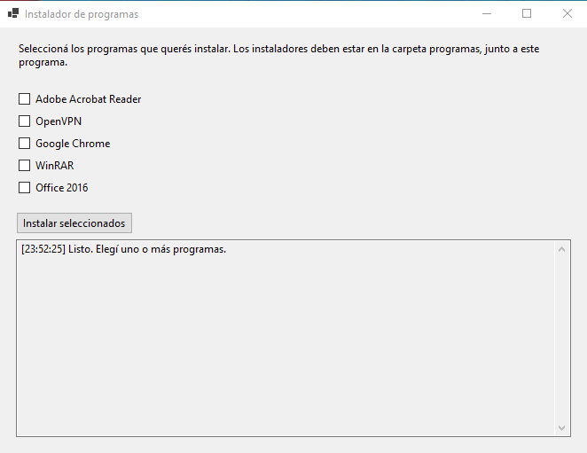

# Instalador de programas silencioso

Proyecto echeo con WinForms .NET 8. Al iniciar el programa se solicita elevación, del cual solo se pedira 1 vez para multiples programas, por lo que Windows muestra un único UAC. Los procesos de instalación se ejecutan desde esa aplicación elevada.

## Archivos de instalación

Los instaladores se deben ubicar en la siguiente ruta, manteniendo sus nombres:

```text
programas/
├── Acrobat/Setup.exe
├── OpenVPN-2.5.7-I602-amd64.msi
├── ChromeSetup.exe
├── WinRAR.exe
├── Office2016.iso
└── config.xml
```

El `config.xml` incluido corresponde a Office 2016. La extensión correcta para el contenido XML es `.xml`, donde se indica la configuracion para la instalacion silenciosa.

## Comandos usados

- Acrobat: `Setup.exe /sPB`
- OpenVPN: `msiexec /i "OpenVPN-2.5.7-I602-amd64.msi" /norestart /passive`
- Chrome: `ChromeSetup.exe /silent`
- WinRAR: `WinRAR.exe /s`
- Office 2016: monta la ISO, ejecuta `setup.exe /config "...\config.xml"`, espera el resultado y desmonta la ISO.

Las instalaciones se procesan en orden, aunque una falle. Al terminar aparece un resumen con el resultado de cada una.

## Como usar

Simplemente se debe marcar los checkbox de los programas a instalar




## Agrega tu programa silencioso
Crea un bat con el nombre del exe y se debe agregar /? o /h


## Crear un bat con tus programas
Se debe crear un bat y una carpeta que se llame programas donde van a estar los instaladores
```
@echo off
setlocal EnableExtensions

title Instalacion silenciosa de programas

:: ==========================================
:: SOLICITAR PERMISOS DE ADMINISTRADOR
:: ==========================================
fltmc >nul 2>&1
if errorlevel 1 (
    echo Solicitando permisos de administrador...
    powershell.exe -NoProfile -Command "Start-Process -FilePath '%~f0' -Verb RunAs"
    exit /b
)

:: Trabajar desde la carpeta donde esta el BAT
pushd "%~dp0"

set "P=%~dp0p"
set "FALLOS=0"

echo.
echo ==========================================
echo    INSTALACION SILENCIOSA DE PROGRAMAS
echo ==========================================
echo.

:: ==========================================
:: GOOGLE CHROME
:: ==========================================
echo [1/2] Instalando Google Chrome...

if exist "%programas%\ChromeSetup.exe" (
    start /wait "" "%P%\ChromeSetup.exe" /silent /install
    if errorlevel 1 (
        echo ERROR: Chrome. Codigo: %errorlevel%
        set /a FALLOS+=1
    ) else (
        echo Chrome: proceso finalizado.
    )
) else (
    echo ERROR: No se encontro el instalador de Chrome.
    set /a FALLOS+=1
)

echo.

:: ==========================================
:: WINRAR
:: ==========================================
echo [2/2] Instalando WinRAR...

if exist "%programas%\WinRAR.exe" (
    start /wait "" "%P%\WinRAR.exe" /S
    if errorlevel 1 (
        echo ERROR: WinRAR. Codigo: %errorlevel%
        set /a FALLOS+=1
    ) else (
        echo WinRAR: proceso finalizado.
    )
) else (
    echo ERROR: No se encontro el instalador de WinRAR.
    set /a FALLOS+=1
)

echo.
echo ==========================================
echo          INSTALACION FINALIZADA
echo ==========================================
echo.

if "%FALLOS%"=="0" (
    echo Todos los procesos finalizaron sin errores reportados.
) else (
    echo Se detectaron %FALLOS% errores.
)

echo.
echo Presione una tecla para salir...
pause >nul

popd
endlocal
exit /b
```
